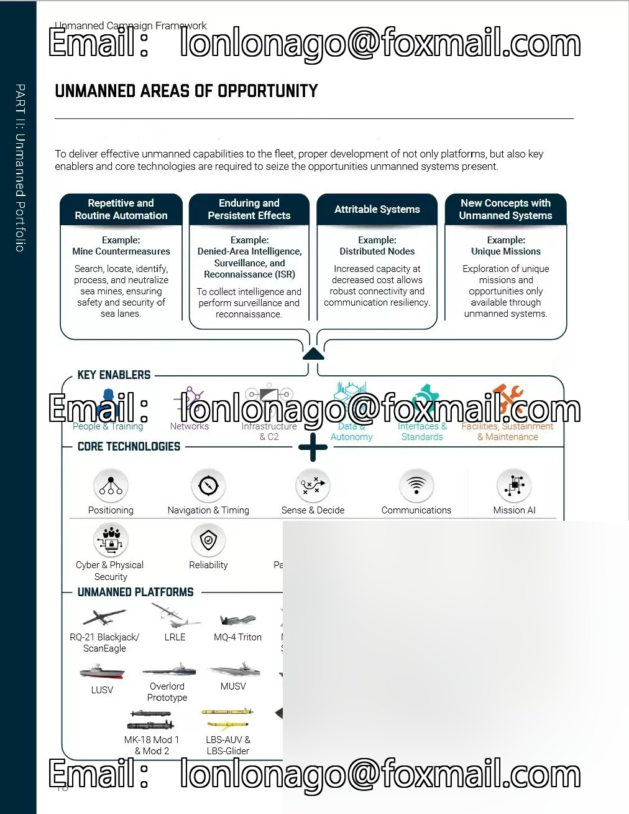
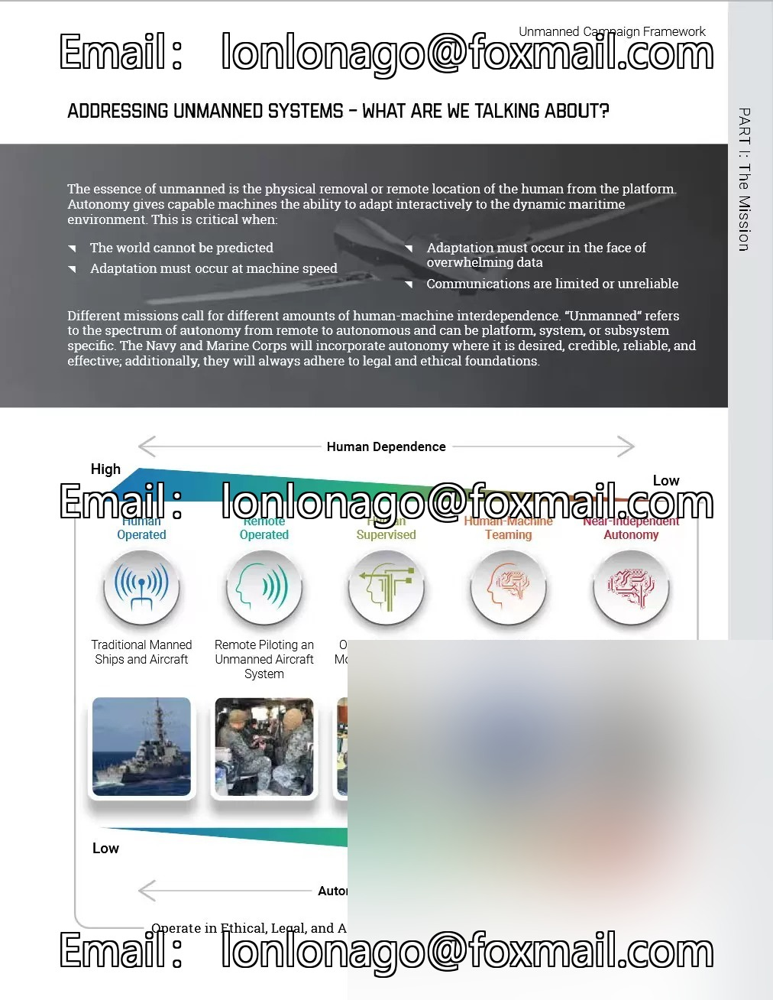

# The United States Navy, the Navy Department, and the Marine Corps jointly released "The" on March 16, 2021

## Body

U.S. Navy, the Department of the Navy, and the Marine Corps jointly released the "Framework for Unmanned System Activities" on March 16, 2021.
I. Content of the materials
1. A strategic document that systematically outlines the application planning of unmanned systems (UAS, UUV, UGV, etc.) in the naval, Marine Corps, and U.S. Navy Aviation Forces fields
2. Key technical domains: autonomy, data and interfaces, platforms and systems, and human-robot interaction
3. Typical platform cases: MQ-21, MQ-9, LUSV, MK-18 Mod 2, etc.
4. Analysis of development visions and challenges for unmanned systems
II. Characteristics of the materials
Authority: Issued by the official source, covering unmanned system technology, combat concepts, and platform systems.

Practicality: Suitable for military enthusiasts, technical research, and strategic analysis reference;
III. , no return or exchange after sale;
Needs direct shooting; contact privately for issues.

The document covers unmanned systems applications across the navy, navy maritime units and air force, key technical directions, platform cases and development visions and challenges; the images display related themes.

<!-- AI_ENRICHED -->

## Images

## Payment

Here is a pay link on Stripe ( https://buy.stripe.com/3cs8yP7sY87d0vu9AB ). Please contact me lonlonago@foxmail.com after funding $89, and I will send you a complete data files , thank you!

